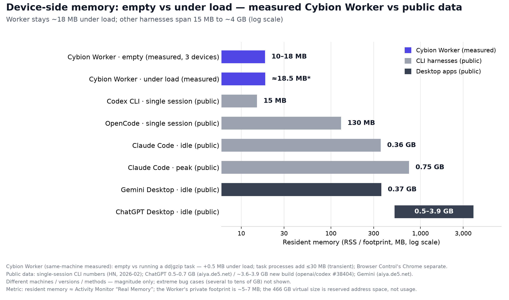
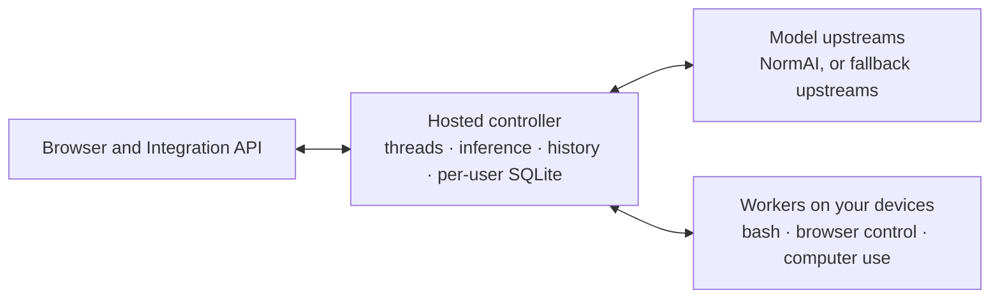

# Cybion

**A hosted control surface for AI work that reaches real machines.**

Cybion is the hosted AI execution service at
[`cybion.ntnl.io`](https://cybion.ntnl.io): an operational harness that turns
OpenAI-compatible models into work on the machines you own. Sign in, pair each
device as a lightweight Worker, and run Threads that execute real work — Bash,
Browser Control, and Computer Use on the machine you choose — guided by
explicit Contexts and a replayable history.

[Open Cybion](https://cybion.ntnl.io) · [Quick start](#quick-start) ·
[Ultimate Machines](#ultimate-machines) · [Integration API](#integration-api)

## Why Cybion

**Explicit context, not hidden memory.** Durable knowledge is a Context you
write — a title, a "use when" description, a body, and a place in a tree —
created, edited, and trashed from the Contexts page or with `write_context`.
Threads discover Contexts on demand (`cybion_list_contexts`, `read_context`)
and read only what a task cites; source material stays on your devices and
network services. Conversations replay from an append-only history, the
conversation header shows the live context size against its budget, and long
Threads compact into checkpoints instead of overflowing.

**Cloud-hosted inference.** Inference runs in the hosted controller, not on
your devices. It holds the upstream connection, retries transient model
failures within a persisted budget, and resumes running Threads after
restarts. Your machines never carry a model credential, and a fresh workspace
gets a [NormAI](https://normai.ntnl.io) upstream automatically — no provider
setup before the first message. Fallback upstreams remain available for
OpenAI-Responses-compatible providers.

**One lightweight Worker per device.** A device joins Cybion with a single
small binary (`./cybion-worker run --background`, a 2–3 MB download) that
keeps no database and no model credential: it opens one outbound connection
and executes what the controller sends. It is ≈10–19 MB resident (private
footprint ~5–7 MB) and stays flat while executing tasks — [see the
measurements](#device-footprint). Pairing is an in-browser authorization with
a short code, configuration is written on the device, and upgrades ship
through the controller's download mirror for networks that cannot reach
GitHub. Builds cover macOS (Apple Silicon / Intel), Linux (x86_64 / ARM64),
Windows, and Android (early development) — iOS is coming soon. Bash, Browser
Control, and Computer Use run on the machine you pick, every call shows which
one, and Workers can be shared with other Cybion users without exchanging
credentials. See [Worker onboarding](docs/worker-onboarding.md).

**Ultimate Machines that keep watch.** Give Cybion a check command and an
interval: the machine stays silent while the check returns 0, and when it
fails, its dedicated Thread is asked to make it pass again. No dashboard to
watch, no alerts to triage. More below.

## Ultimate Machines

An Ultimate Machine runs one bash command on a Worker on a fixed interval and
stays silent while the command returns 0. Its only message is a request to fix
what the command reports; in the ideal case it never sends anything.

- On failure, the controller appends a repair request to the machine's own
  Thread: the command, the exit code, the tail of its output, the optional
  intent, and the success criterion — make the command return 0 again. The
  Thread is a normal Thread: readable, steerable, and backed by the same
  history as everything else.
- Offline Workers notify once per episode through Linkit; a run that never
  settles is declared lost and retried on the next interval.
- Create and manage machines on the Machines page (`#/machines`) or from a
  conversation. Pause, run once immediately, or edit at any time; the first
  run starts right after creation, and machine runs stay out of usage
  statistics.

```sh
# An example check — keep the root disk below 90%
test $(df -Pk / | awk 'NR==2 {print $5}' | tr -d %) -lt 90
```

The name comes from the Bell Labs joke box whose only function is to switch
itself off; Cybion's version keeps your services running instead. See
[Ultimate machines](docs/machines.md).

## Device footprint

The Worker is small, and stays small under load. Measured on three machines
(macOS 26.5 and Debian 13; October 2026, idle and while executing a task):
**≈10–19 MB resident** — private footprint ~5–7 MB — from a single
process that holds no local database and no model credentials.



For scale, public single-session numbers for other harnesses: Codex CLI ~15 MB,
OpenCode ~130 MB, Claude Code ~360–750 MB, ChatGPT Desktop 0.5–3.9 GB —
different machines, versions and methods, so treat it as a magnitude
comparison only. Sources: [HN](https://news.ycombinator.com/item?id=46904791),
[aiya.de5.net](https://aiya.de5.net/t/topic/197),
[openai/codex#38404](https://github.com/openai/codex/issues/38404).

"Resident" here is RSS ≈ Activity Monitor's "Real Memory". The virtual
address space macOS reports for the Worker (466 GB) is reserved address space,
not memory usage. Task processes spawned while working, and the separate
Chrome instance that Browser Control launches, are counted separately.

## Quick start

1. **Sign in** at [cybion.ntnl.io](https://cybion.ntnl.io).
2. **Connect a device** — open **Workers → Connect a device**, choose the
   target, download, and start it:

   ```sh
   ./cybion-worker run --background        # macOS / Linux
   .\cybion-worker.exe run --background    # Windows PowerShell
   ```

   Authorize the pairing code in Cybion; the configuration is written on the
   device automatically, and the guide verifies execution before reporting
   ready.
3. **Start a Thread** — for example: "Check what is filling up `/var` on the
   Linux box and clean it up."

New here? **Using Cybion** (`/#/help`) covers Threads, Contexts, and Worker
concepts; [First-use guidance](docs/onboarding.md) has the details.

## What you get

| Area | What it does | Docs |
| --- | --- | --- |
| Threads | Durable conversations with full execution history; server-side filters and search; archive, restore, and delete; read-only sharing with other Cybion users. | [Threads](docs/threads.md) · [Sharing](docs/thread-sharing.md) · [Recovery](docs/thread-recovery.md) |
| Contexts | An explicit knowledge tree read on demand; create, edit, and trash from the UI or `write_context`; ships with a read-only Common Context. | [Contexts](docs/context.md) · [Compaction](docs/context_compacting.md) |
| Workers | Bash, Browser Control, and Computer Use on macOS, Linux, Windows, and Android (early development); pairing, remote upgrades, and worker sharing; iOS coming soon. | [Onboarding](docs/worker-onboarding.md) · [Sharing](docs/worker-sharing.md) |
| Ultimate Machines | Scheduled self-checks with automatic repair Threads; Linkit notifications when a device is offline. | [Ultimate machines](docs/machines.md) |
| Models & tools | NormAI upstream out of the box; fallback upstreams with per-upstream model catalogs; web search and image generation tools; per-thread model, reasoning effort, and context budget. | [Service overview](docs/introduction.md) |
| Integration API | Per-user API keys; create Threads, append inputs, and read history; `external_ref` mapping for integrations. | [Integration API](#integration-api) |
| Isolation & audit | One SQLite database per user with owner-only permissions; append-only history; usage statistics; system resource monitor for the root user. | [History](docs/history.md) · [Usage](docs/usage-statistics.md) · [Boundary](docs/product-boundary.md) |

## How it fits together



Each user's state lives in an isolated SQLite database, and Workers reach the
controller over a single outbound connection — no listening ports, no model
credentials, no local database on the device. Binary media (pasted and
generated images) lives outside the database in a content-addressed object
store under `~/.cybion/objects/`, and records reference it; see
[docs/objects.md](docs/objects.md).

## Integration API

Create an API key in the Cybion UI. The key is scoped to one Auth Mini user and
is shown only once:

```sh
export CYBION_API_KEY='cyb_<user-id>_<secret>'
curl -X POST https://cybion.ntnl.io/v1/threads \
  -H "Authorization: Bearer $CYBION_API_KEY" \
  -H 'Content-Type: application/json' \
  -d '{"title":"Summarize the release","model":"deepseek-flash"}'
```

| Method | Path | Purpose |
| --- | --- | --- |
| `POST` | `/v1/threads` | Create a thread. |
| `GET` | `/v1/threads/{id}` | Read thread metadata and request state. |
| `GET` | `/v1/threads/{id}/history` | Read every durable record in index order. |
| `POST` | `/v1/threads/{id}/inputs` | Append input and start inference. |

`POST /v1/threads/{id}/inputs` accepts
`{"input":"...","images":["data:image/png;base64,..."]}` and returns the new
`record_idx`; `images` is optional, and each entry must be a png/jpeg/webp/gif
base64 data URL. Poll the thread and history endpoints for the result.

## Documentation

- [First-use guidance](docs/onboarding.md) — Threads, Contexts, and Workers.
- [Threads](docs/threads.md), [thread statuses](docs/thread-status.md),
  [usage and drafts](docs/thread-usage-and-drafts.md),
  [recovery](docs/thread-recovery.md), [sharing](docs/thread-sharing.md).
- [Contexts](docs/context.md) and [context compaction](docs/context_compacting.md).
- [Worker onboarding](docs/worker-onboarding.md) and [worker sharing](docs/worker-sharing.md).
- [Ultimate machines](docs/machines.md).
- [History table](docs/history.md) and [usage statistics](docs/usage-statistics.md).
- [Service overview](docs/introduction.md) and [Responses parity notes](docs/responses-codex-parity.md).
- [Product boundary](docs/product-boundary.md) — detailed behavior, delivery,
  and storage semantics (the former README fine print).

In the app: **Using Cybion** (`/#/help`), **History** (`/#/history`),
**Machines** (`/#/machines`).

## Development and release

```sh
npm --prefix web ci
npm --prefix web run check
npm --prefix web run build
cargo fmt --check
cargo clippy --all-targets --locked -- -D warnings
cargo test --locked
```

This repository holds the hosted controller (Rust) and the web console
(React); the release binary embeds `web/dist` and targets Linux x86_64.
Production state is under `/root/.cybion`; the current schema uses `users/`,
and databases from the earlier hosted layout are intentionally not migrated.
New user databases are created on first use. CI runs the full check set
(browser e2e, parity, smoke and shell tests, cargo) — see
[`.github/workflows/ci.yml`](.github/workflows/ci.yml).

Related repositories: [`cybion-worker`](https://github.com/zccz14/cybion-worker)
for desktop and headless Workers, and
[`cybion-worker-for-android`](https://github.com/zccz14/cybion-worker-for-android)
for the Android app.

Pushing a `v*` tag publishes the binary and invokes the AWS Systems Manager
deployment job. The repository variables are `AWS_DEPLOY_ROLE_ARN`,
`AWS_REGION`, and `EC2_INSTANCE_ID`. Release history is on
[GitHub Releases](https://github.com/zccz14/cybion/releases).
