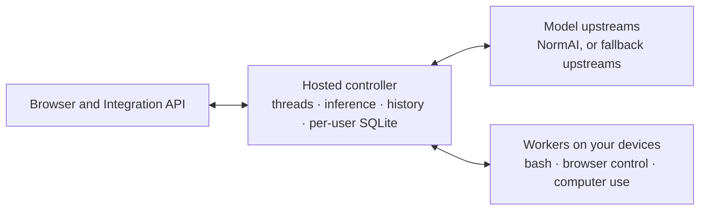

# Cybion

**A hosted control surface for AI work that reaches real machines.**

Cybion is the hosted AI execution service at
[`cybion.ntnl.io`](https://cybion.ntnl.io) — with a mainland-China entry at
[`cybion.ntnl.top`](https://cybion.ntnl.top) — an operational harness that
turns OpenAI-compatible models into work on the machines you own. Sign in, pair
each device as a lightweight Worker, and run Threads that execute real work —
Bash, Browser Control, and Computer Use on the machine you choose — from
context you control explicitly and a replayable archive.

[Open Cybion](https://cybion.ntnl.io) ·
[Mainland China](https://cybion.ntnl.top) · [Quick start](#quick-start) ·
[Context](#context-four-kinds-three-you-control) ·
[Ultimate Machines](#ultimate-machines) ·
[Integration API](#integration-api)

## Why Cybion

**Explicit context, not hidden memory.** A Thread works from exactly four
kinds of context — Notes (便签), Manuals (手册), the Archive (档案), and the
World (世界) — and Cybion stores the first three so a Thread can read them
whole and you can audit them (see
[Context](#context-four-kinds-three-you-control)). Durable knowledge is a
Manual you write — a title, a "use when" description, a body, and a place in a
tree — created, edited, and trashed from the Manuals page or with
`write_manual`, and lockable there so a hand-written manual stays out of the
Thread's reach. Threads find Manuals on demand with `list_manuals` and load
only what a task cites; source material stays on your devices and network
services. A Thread that must keep working from a Manual says so with
`load_manual`, and the controller then delivers its current copy into every
request — refreshed by itself when the Manual changes and restored after a
compaction — until the Thread releases it with `unload_manual`. Sticky notes
are the opposite kind of context: short items a Thread must visibly cross out,
so "finished" and "dropped" never look alike. Conversations replay from an
append-only history, the conversation header shows the live context size
against its budget and the Manuals the Thread keeps loaded, each refreshed by
the controller as soon as it is edited, and long Threads compact into
checkpoints instead of overflowing.

**Cloud-hosted inference.** Inference runs in the hosted controller, not on
your devices. It holds the upstream connection, retries transient model
failures within a persisted budget, and resumes running Threads after
restarts. Your machines never carry a model credential, and a fresh workspace
gets a [NormAI](https://normai.ntnl.io) upstream automatically — no provider
setup before the first message. Fallback upstreams remain available for
OpenAI-Responses-compatible providers.

**One lightweight Worker per device.** A device joins Cybion with a single
small binary (`./cybion-worker run --background`, a 2–3 MB download) that
keeps no database and no model credential: it opens one outbound connection
and executes what the controller sends. It is ≈10–19 MB resident (private
footprint ~5–7 MB) and stays flat while executing tasks — [see the
measurements](#device-footprint). Pairing is an in-browser authorization with
a short code, configuration is written on the device, and upgrades ship
through the controller's download mirror for networks that cannot reach
GitHub. Builds cover macOS (Apple Silicon / Intel), Linux (x86_64 / ARM64)
and Windows, plus Android and
[iOS](https://github.com/zccz14/cybion-worker-for-ios) apps that are both in
early development. Bash, Browser Control, and Computer Use run on the machine
you pick, every call shows which one, and Workers can be shared with other
Cybion users without exchanging credentials. See
[Worker onboarding](docs/worker-onboarding.md).

**Ultimate Machines that keep watch.** Give Cybion a check command and an
interval: the machine stays silent while the check returns 0, and when it
fails, its dedicated Thread is asked to make it pass again. No dashboard to
watch, no alerts to triage. More below.

## Context: four kinds, three you control

Cybion's premise is that a Thread's working material can be named, and that
naming it is what makes it governable. Every piece of that material is exactly
one of four kinds:

| Kind | 中文 | Surface | Lifetime | Stored | Under your control |
| --- | --- | --- | --- | --- | --- |
| Note | 便签 | `#/notes`, `add_notes` / `cross_out_notes` | clears to zero | yes, per Thread | yes |
| Manual | 手册 | `#/manuals`, `write_manual` / `load_manual` | converges | yes, revisions | yes |
| Archive | 档案 | `#/archive` | only grows | yes, append-only | yes |
| World | 世界 | none | unbounded | **no** | **no** |

The first three kinds are the context you control explicitly: they are stored
rather than inferred, they survive compaction, and a Thread reads them whole
instead of guessing at them. They are ordered by lifetime — a Note should
reach zero, a Manual converges and then stays put, and the Archive only
grows.

The fourth is the World: **Universe − Notes − Manuals − Archive**. Everything
outside those three — your servers and their live state, the network,
third-party pages, a file that changed under you — is World. It cannot be
stored whole, cannot be modelled, and changes without asking you. A Thread
reaches it only by sampling: `bash`, `browser_control`, `computer_use`,
`view_image`, `normai_web_search`. What comes back is evidence, and evidence
lands in the Archive; it is never a copy of the World. There is no World page,
no World tool group, and deliberately no `world_id` anywhere in the product.

The model explains the design. A Manual that says where the World is reachable
— an SSH host, a NAS, a credential, a server inventory — is a claim, not the
World itself; a claim can go stale, so it carries a `Use When` condition that
decides when it is worth reading, and can be locked so it is not rewritten
carelessly. Notes are short-lived because they are a debt, not knowledge. The
Archive is append-only because a record that can be edited cannot settle an
argument about what happened.

The four kinds are also a completeness rule: anything that seems to fit none
of them is a gap in the model, not an exception — either it is one of the four
named badly, or the model has to change. There is no fifth kind and no "other"
bucket. The classifier and naming rules are in the
[glossary](docs/glossary.md); storage and replay are in
[context](docs/context.md), and the short-lived kind is in
[sticky notes](docs/notes.md).

## Ultimate Machines

An Ultimate Machine runs one bash command on a Worker on a fixed interval and
stays silent while the command returns 0. Its only message is a request to fix
what the command reports; in the ideal case it never sends anything.

- On failure, the controller appends a repair request to the machine's own
  Thread: the command, the exit code, the tail of its output, the optional
  intent, and the success criterion — make the command return 0 again. The
  Thread is a normal Thread: readable, steerable, and backed by the same
  history as everything else.
- Offline Workers notify once per episode through Linkit; a run that never
  settles is declared lost and retried on the next interval.
- Create and manage machines on the Machines page (`#/machines`) or from a
  conversation. Pause, run once immediately, edit or delete at any time; the
  first run starts right after creation, a finished repair turn re-checks the
  command at once, pausing also stops the repair Thread's current turn, and
  deleting keeps the Thread. Machine runs stay out of usage statistics.

```sh
# An example check — keep the root disk below 90%
test $(df -Pk / | awk 'NR==2 {print $5}' | tr -d %) -lt 90
```

The name comes from the Bell Labs joke box whose only function is to switch
itself off; Cybion's version keeps your services running instead. See
[Ultimate machines](docs/machines.md).

## Device footprint

The Worker is small, and stays small under load. Measured on three machines
(macOS 26.5 and Debian 13; October 2026, idle and while executing a task):
**≈10–19 MB resident** — private footprint ~5–7 MB — from a single
process that holds no local database and no model credentials.


For scale, public numbers from other projects: Codex CLI ~15 MB, OpenCode
~130 MB, Claude Code ~360–750 MB, ChatGPT Desktop 0.5–3.9 GB. Pi 1.0 on
Rivet reports 0.82 MB per live session — incremental session memory inside
one backend process (RSS baseline 223 MB), not a per-process footprint;
idle sessions hibernate. Machines, versions and methods differ, so treat
these as magnitude comparisons only. Sources:
[HN](https://news.ycombinator.com/item?id=46904791),
[aiya.de5.net](https://aiya.de5.net/t/topic/197),
[openai/codex#38404](https://github.com/openai/codex/issues/38404),
[Rivet](https://rivet.dev/changelog/2026-10-01-introducing-pi-1-0-for-rivet/).

"Resident" here is RSS ≈ Activity Monitor's "Real Memory". The virtual
address space macOS reports for the Worker (466 GB) is reserved address space,
not memory usage. Task processes spawned while working, and the separate
Chrome instance that Browser Control launches, are counted separately.

## Quick start

1. **Sign in** at [cybion.ntnl.io](https://cybion.ntnl.io) — or, from
   mainland China, at [cybion.ntnl.top](https://cybion.ntnl.top): the same
   workspace through a reverse-proxied entry, with no separate account.
2. **Connect a device** — open **Workers → Connect a device**, choose the
   target, download, and start it:

   ```sh
   ./cybion-worker run --background        # macOS / Linux
   .\cybion-worker.exe run --background    # Windows PowerShell
   ```

   Authorize the pairing code in Cybion; the configuration is written on the
   device automatically, and the guide verifies execution before reporting
   ready.
3. **Start a Thread** — for example: "Check what is filling up `/var` on the
   Linux box and clean it up."

New here? **Using Cybion** (`/#/help`) covers Threads, Manuals, and Worker
concepts; [First-use guidance](docs/onboarding.md) has the details.

## What you get

| Area | What it does | Docs |
| --- | --- | --- |
| Threads | Durable conversations with full execution history; server-side filters and search; archive, restore, and delete; read-only sharing with other Cybion users. | [Threads](docs/threads.md) · [Sharing](docs/thread-sharing.md) · [Recovery](docs/thread-recovery.md) |
| Manuals | An explicit knowledge tree read on demand; create, edit, and trash from the UI or `write_manual`, and lock from the UI so a Thread cannot rewrite a hand-written manual; ships with a read-only Common Manual. | [Manuals](docs/context.md) · [Compaction](docs/context_compacting.md) |
| Notes | Short items that clear to zero: written by a Thread and visible only there, injected into every request it runs, crossed out by that Thread and torn off only by you. | [Sticky notes](docs/notes.md) |
| Workers | Bash, Browser Control, and Computer Use on macOS, Linux, and Windows, with Android and iOS apps in early development; pairing, remote upgrades, and worker sharing. | [Onboarding](docs/worker-onboarding.md) · [Sharing](docs/worker-sharing.md) |
| Ultimate Machines | Scheduled self-checks with automatic repair Threads; Linkit notifications when a device is offline. | [Ultimate machines](docs/machines.md) |
| Models & tools | NormAI upstream out of the box; fallback upstreams with per-upstream model catalogs; web search, image generation, and audio transcription tools; per-thread model, reasoning effort, context budget, and speech-to-text model. | [Service overview](docs/introduction.md) · [Audio input](docs/audio-input.md) |
| Integration API | Per-user API keys; create Threads, append inputs, and read history; `external_ref` mapping for integrations. | [Integration API](#integration-api) |
| Isolation & audit | One SQLite database per user with owner-only permissions; append-only history; usage statistics; system resource monitor for the root user. | [History](docs/history.md) · [Usage](docs/usage-statistics.md) · [Boundary](docs/product-boundary.md) |

## How it fits together



Each user's state lives in an isolated SQLite database, and Workers reach the
controller over a single outbound connection — no listening ports, no model
credentials, no local database on the device. Binary media (pasted and
generated images) lives outside the database in a content-addressed object
store under `~/.cybion/objects/`, and records reference it; see
[docs/objects.md](docs/objects.md).

## Integration API

Create an API key in the Cybion UI. The key is scoped to one Auth Mini user and
is shown only once. Both web entries serve the same API: from mainland China,
put `https://cybion.ntnl.top` where the commands below use
`https://cybion.ntnl.io`.

```sh
export CYBION_API_KEY='cyb_<user-id>_<secret>'
curl -X POST https://cybion.ntnl.io/v1/threads \
  -H "Authorization: Bearer $CYBION_API_KEY" \
  -H 'Content-Type: application/json' \
  -d '{"title":"Summarize the release","model":"deepseek-flash"}'
```

| Method | Path | Purpose |
| --- | --- | --- |
| `POST` | `/v1/threads` | Create a thread. |
| `GET` | `/v1/threads/{id}` | Read thread metadata and request state. |
| `GET` | `/v1/threads/{id}/history` | Read every durable record in index order. |
| `POST` | `/v1/threads/{id}/inputs` | Append input and start inference. |

`POST /v1/threads/{id}/inputs` accepts
`{"input":"...","images":["data:image/png;base64,..."]}` and returns the new
`record_idx`; `images` is optional, and each entry must be a png/jpeg/webp/gif
base64 data URL. Poll the thread and history endpoints for the result.

## Documentation

- [First-use guidance](docs/onboarding.md) — Threads, Manuals, and Workers.
- [Glossary](docs/glossary.md) — Context and its four kinds, plus the
  naming rules.
- [Threads](docs/threads.md), [thread statuses](docs/thread-status.md),
  [usage and drafts](docs/thread-usage-and-drafts.md),
  [recovery](docs/thread-recovery.md), [sharing](docs/thread-sharing.md).
- [Manuals](docs/context.md) and [context compaction](docs/context_compacting.md).
- [Sticky notes](docs/notes.md) — the zero-target kind of context.
- [Math rendering](docs/math.md) — how formulas reach every Markdown surface through the shared renderer.
- [Worker onboarding](docs/worker-onboarding.md) and [worker sharing](docs/worker-sharing.md).
- [Ultimate machines](docs/machines.md).
- [History table](docs/history.md) and [usage statistics](docs/usage-statistics.md).
- [Service overview](docs/introduction.md) and [Responses parity notes](docs/responses-codex-parity.md).
- [Product boundary](docs/product-boundary.md) — detailed behavior, delivery,
  and storage semantics (the former README fine print).

In the app: **Using Cybion** (`/#/help`), **History** (`/#/archive`),
**Machines** (`/#/machines`).

## Viewer clients

The hosted web app at [`cybion.ntnl.io`](https://cybion.ntnl.io) — or its
mainland-China entry, [`cybion.ntnl.top`](https://cybion.ntnl.top) — is the
control surface, and a modern browser runs it directly. Some platforms cannot
use the browser they have — an Android WebView too old for the session check, or
a desktop where the user wants an app icon and a real window. [`clients/`](clients/)
packages the web app into small native **viewer** shells that render it and
nothing else:

- [`clients/android/`](clients/android/) — a minimal Java `WebView` activity.
- [`clients/macos/`](clients/macos/) — a minimal Swift `WKWebView` app bundle.

A shell holds no model, no Worker, and no credentials: execution still happens
on a paired [Worker](docs/worker-onboarding.md). Both shells inject a shared
[Ed25519 shim](clients/shell/ed25519-polyfill.js) before any page script so the
session check passes where `crypto.subtle` lacks Ed25519. See
[clients/README.md](clients/README.md) and
[clients/docs/compatibility.md](clients/docs/compatibility.md).

## Development and release

```sh
pnpm --dir web install --frozen-lockfile
pnpm --dir web run check
pnpm --dir web run build
cargo fmt --check
cargo clippy --all-targets --locked -- -D warnings
cargo test --locked
```

This repository holds the hosted controller (Rust) and the web console
(React); the release binary embeds `web/dist` and targets Linux x86_64.
Production state is under `/root/.cybion`; the current schema uses `users/`,
and databases from the earlier hosted layout are intentionally not migrated.
New user databases are created on first use. CI runs the full check set
(browser e2e, parity, smoke and shell tests, cargo) — see
[`.github/workflows/ci.yml`](.github/workflows/ci.yml).

Related repositories: [`cybion-worker`](https://github.com/zccz14/cybion-worker)
for desktop and headless Workers,
[`cybion-worker-for-android`](https://github.com/zccz14/cybion-worker-for-android)
for the Android app, and
[`cybion-worker-for-ios`](https://github.com/zccz14/cybion-worker-for-ios) for
the iPhone app — a Rust core with an in-process command engine, installed from
Xcode or an unsigned IPA rather than the App Store. The iOS app is not part of
the controller's download mirror yet.

Pushing a `v*` tag publishes the binary and invokes the AWS Systems Manager
deployment job. The repository variables are `AWS_DEPLOY_ROLE_ARN`,
`AWS_REGION`, and `EC2_INSTANCE_ID`. Release history is on
[GitHub Releases](https://github.com/zccz14/cybion/releases).
